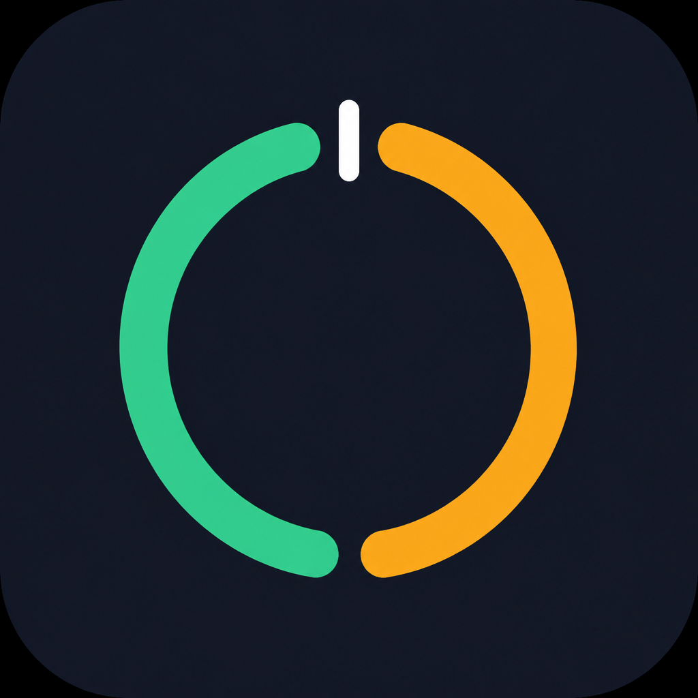
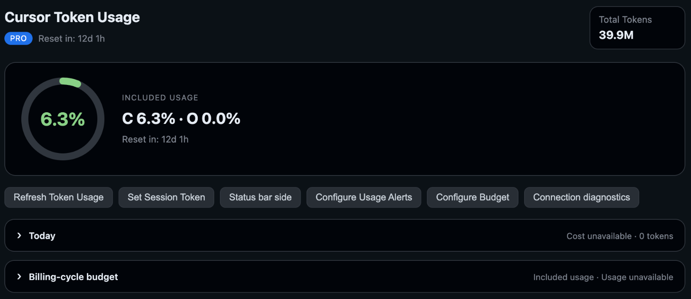
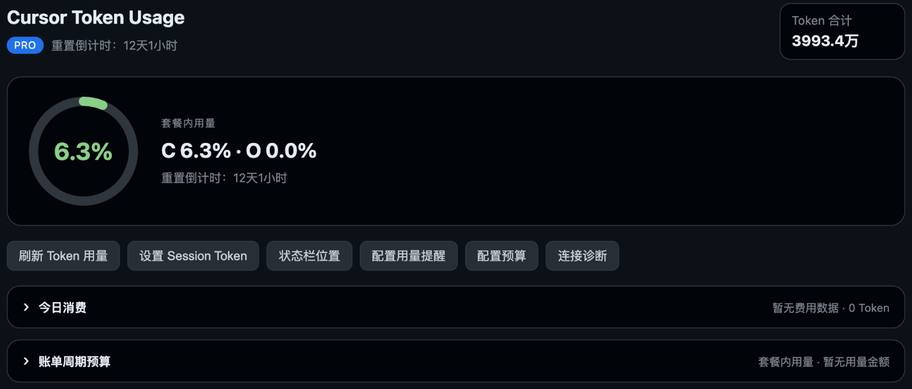

<div align="center">



# Cursor Token Usage

**A Cursor IDE extension that shows live Cursor token billing on the status bar**

[](https://github.com/Akito-Go/Cursor-Token-Usage/releases)
[](https://open-vsx.org/extension/akitogo/cursor-token-usage)
[](LICENSE)

[English](#cursor-token-usage) · [中文](#中文) · [Quick Start](#quick-start) · [Features](#features) · [Authentication](#authentication) · [UI](#ui) · [FAQ](#faq)

</div>

---

Cursor now bills by tokens in two pools (not the old “fast-premium requests + dollars” model). This extension reads the live dashboard APIs and switches the display by account type: individual accounts see two-pool percentages; Team / Enterprise see included spend vs limit.

## Features

| **Status bar** Individual: `C xx% · O xx%`. Team / Enterprise: included used vs limit (API cents, not a local estimate) | **Details panel** Click the status bar for a usage ring, colored bars, per-model tokens, recent events with cost, and a trend chart |
| --- | --- |
| **Account-aware** Type comes from the API (`individual` / `team` / `enterprise`), not guessed from the token | **Usage alerts** Notify when the delta between two polls exceeds a threshold; metrics and thresholds are configurable |

**Also:**

- Auto refresh, default 30 seconds; slower while the window is unfocused; pauses when the status bar, alerts, and details panel are all unused; backs off after consecutive failures
- Status-bar polls fetch one page of up to 100 events; opening or refreshing the details panel fetches billing-cycle history, up to 30 pages (3,000 events) per refresh
- Failed or capped history fetches are marked incomplete; fetch failures show warnings, and available cached data is retained within the same account and billing cycle
- English / Chinese UI, follows the editor language
- Universal VSIX for macOS / Windows / Linux; after first-run consent, reads the local Cursor session (`state.vscdb`)
- UI extension (`extensionKind: ui`): on SSH Remote, WSL, or Dev Containers it still reads the **local** login
- Shows `$` for a positive per-event cost and for summary amounts, including a real `$0.00`; does not estimate invoices from list prices
- Trend chart defaults to the last 7 days; From / To can span months within the billing cycle
- Today’s usage shows API-reported cost, tokens, requests and top models; a zero event-cost total is labeled “API did not return a cost”
- Billing-cycle budgets notify at 50%, 80% and 100%; connection diagnostics show authentication source, endpoint results and polling state

## Quick Start

### From Open VSX

Install from [Open VSX](https://open-vsx.org/extension/akitogo/cursor-token-usage) (Cursor’s extension marketplace). Search `Cursor Token Usage`, or:

```bash
cursor --install-extension akitogo.cursor-token-usage
```

### From a VSIX

1. For this source version, build `cursor-token-usage-1.1.2.vsix` using [Build from Source](#build-from-source), or obtain the matching version from [Releases](https://github.com/Akito-Go/Cursor-Token-Usage/releases) if published
2. Drag it into Cursor, or `Cmd+Shift+P` (Windows: `Ctrl+Shift+P`) → `Extensions: Install from VSIX...`
3. Run `Developer: Reload Window`

The status bar should show usage. If the session is missing it shows **Set Token** — see Authentication.

## Authentication

On first launch the extension asks before reading the local Cursor session. After you allow it, it reads `cursorAuth/accessToken` and the user id from `state.vscdb`, builds a `WorkosCursorSessionToken` cookie, and sends it to **`cursor.com` only**. You can decline and set a token manually instead.

| OS | Session file |
| --- | --- |
| macOS | `~/Library/Application Support/Cursor/User/globalStorage/state.vscdb` |
| Windows | `%APPDATA%\Cursor\User\globalStorage\state.vscdb` |
| Linux | `~/.config/Cursor/User/globalStorage/state.vscdb` |

Auto-detect needs **Python 3** on PATH (`python3` / `python`, or the Windows `py` launcher). Without Python, use **Set Session Token**; the rest of the extension still works.

If auto-detect fails:

1. Command Palette → **Cursor Token Usage: Set Session Token**
2. Paste `WorkosCursorSessionToken` (format: `userId%3A%3AaccessToken`)
3. The token is stored in VS Code SecretStorage, never in `settings.json`

To copy the cookie: open [cursor.com](https://cursor.com) → DevTools → Application → Cookies → `WorkosCursorSessionToken`.

**Remote workspaces:** this extension runs in the local Cursor process. Do not install it on the SSH / WSL / container host.

## UI



Usage overview shown above. Scroll in the actual panel for trends, model totals, and recent events.

Recent usage is a table of the latest rows (`displayCount`, default 5): time, model, kind, tokens, and cost. A positive per-request amount from the events API is shown in dollars. A missing amount or an explicit zero is labeled “API did not return a cost”. Expanding the same row in the sidebar shows that cost. Included spend, On-Demand, and the billing-cycle budget still show `$0.00` when the summary API reports zero.

Bar colors: green < 40%, yellow < 80%, orange ≥ 80%, red ≥ 100%. Usage ≥ 80% tints the status bar warning; ≥ 100% tints it error.

Panel buttons: Refresh, Set Session Token, status bar side, Configure Alerts, Configure Budget, Connection Diagnostics.

**Today** and **Billing-cycle budget** are collapsed by default to keep the trend chart prominent. Click either heading (or focus it with Tab and press Enter/Space) to expand or collapse it. Collapsed summaries retain key amounts, tokens, budget progress and partial-data/paused-alert indicators. Each section's state is saved locally and restored after refresh, reopening the panel or reloading Cursor.

The panel uses up to 1,000 px of available width. The trend chart is 300 px tall and redraws to fit the panel; date-label density adapts to its width. Collapsing a section or resizing the panel preserves the selected dates, model and Token/Cost tab.

Trend chart: Token (stacked input / output / cache + line) or Cost (bars + line). Date inputs are bounded by the billing cycle and default to the last 7 days. The Cost tab only draws when at least one event cost is greater than zero. Background polls update the status bar and panel status banners while preserving the chart and date selection. Fetch errors appear immediately in an open panel; after recovery, a banner asks you to Refresh for current details.

## Configuration

| Setting | Default | Description |
| --- | --- | --- |
| `cursorTokenUsage.budgetAmount` | 0 | Billing-cycle budget in USD; 0 disables budget alerts |
| `cursorTokenUsage.budgetMetric` | `onDemand` | Budget basis: `onDemand` or `included`; global application setting |
| `cursorTokenUsage.displayCount` | 5 | Recent usage rows in the details panel (does not limit the trend chart) |
| `cursorTokenUsage.pollingInterval` | 30 | Poll interval in seconds (5–300) |
| `cursorTokenUsage.showStatusBar` | true | Show the status bar item |
| `cursorTokenUsage.statusBarAlignment` | `right` | Status bar side: `left` / `right` |
| `cursorTokenUsage.alertEnabled` | true | Enable usage-change alerts |
| `cursorTokenUsage.alertItems` | `newSession` `overallSpending` `cursorModels` `otherModels` `totalTokens` | Metrics to watch |
| `cursorTokenUsage.alertThreshold.newSession` | 2 | New usage requests in one poll |
| `cursorTokenUsage.alertThreshold.overallSpending` | 1 | Included spend change ($) |
| `cursorTokenUsage.alertThreshold.cursorModels` | 10 | Cursor Models pool change (%) |
| `cursorTokenUsage.alertThreshold.otherModels` | 10 | Other Models pool change (%) |
| `cursorTokenUsage.alertThreshold.onDemandSpending` | 1 | On-demand spend change ($) |
| `cursorTokenUsage.alertThreshold.totalTokens` | 100000 | Total tokens change |

## Commands

| Command | What it does |
| --- | --- |
| Show Token Usage Details | Open the details panel (same as clicking the status bar) |
| Refresh Token Usage | Fetch usage; wait for an active poll first, and fetch history if the details panel is open |
| Set Session Token | Paste / clear the session token |
| Set Polling Interval | 5–300 seconds |
| Set Status Bar Side | Left / right |
| Configure Usage Alerts | Toggle, pick metrics, set thresholds |
| Configure Billing-Cycle Budget | Select the cost basis and budget amount |
| Show Connection Diagnostics | Open a read-only report of connection and polling state |

## Usage Alerts

1. Command Palette → **Configure Usage Alerts**, or the Alerts button in the details panel
2. Enable alerts → pick metrics → set thresholds
3. Monitors: new requests, included spend, Cursor Models %, Other Models %, On-Demand spend, total tokens
4. A threshold of `0` means any positive increase fires an alert

> Thresholds are the **positive delta between consecutive successful polls** for the same account and billing cycle, not a lifetime or absolute cap. Example: `onDemandSpending = 1.0` fires when on-demand spend rises by $1.00 or more between those polls.

New-request alerts work with the details panel closed. They count newly observed requests in the fetched page; loading older history does not trigger them. A background poll fetches at most 100 events, so requests beyond that page may be missed during busy periods or long gaps. Opening details loads more history but does not retroactively alert on older requests.

Changing the account or billing cycle resets the alert baseline. The first successful poll after a fetch failure establishes a new baseline; event or model-total failures also suppress the affected alerts during failure and the first recovery poll.

## Budget, Today and Diagnostics

**Budget:** use **Configure Budget** in the panel or **Configure Billing-Cycle Budget** in the Command Palette. Choose **On-Demand** (default) or **Included usage**, then enter a USD amount with up to two decimal places. These are separate API amounts; the extension does not add them together. `0` disables the budget. Both budget settings apply globally, and `alertEnabled` also controls budget notifications.

Budget alerts use absolute billing-cycle usage, so gradual consumption can reach a threshold even when no single poll triggers a usage-change alert. Each 50%, 80% and 100% milestone is remembered across reloads. If one poll reaches several new levels, only the highest is notified and lower levels are considered reached. Configuring a budget below current usage can notify immediately. A new account, billing cycle, budget amount or cost basis starts a separate milestone record. Up to 100 recent combinations are retained locally as hashed scope keys and reached levels; session tokens are not stored in this record. Missing selected amounts or invalid cycle dates suppress budget alerts.

**Today:** the details panel shows cost, tokens, request count and the top three models by tokens. “Today” uses the computer’s local timezone, limited to the current billing cycle and the last fetched snapshot. The status-bar tooltip includes today’s tokens and requests. The card sums positive per-event cents. A today total of zero is labeled “API did not return a cost”. If no event included a cost field, it stays “Cost unavailable”. Partially priced or incomplete history is labeled, and event costs may differ from the invoice. Refresh the details panel to fetch more history and update these cards.

**Diagnostics:** use **Connection Diagnostics** in the panel or **Show Connection Diagnostics** in the Command Palette. The output report includes the last-used authentication source (local session / manual token / unavailable), last attempt and successful fetch, summary/events/model endpoint results, consecutive failures, current polling interval and cached-history completeness. It displays no token, cookie or raw account ID and sends no report anywhere. The report is a snapshot: refresh usage and reopen diagnostics for new results. A timed-out poll can leave endpoint results unknown.

## FAQ

**Why not estimate dollars?**

Self-serve usage events often return `$0` (`chargedCents: 0`) even when tokens were used. Token × public list price will not match the invoice: included quota, Team / Enterprise discounts, and Cursor Token Rate are applied server-side. `$` is shown only when the API returns a positive per-event amount, or a summary amount from the billing API. A missing or zero event cost is labeled “API did not return a cost” in Recent usage and on a zero Today total. Token counts are always tokens. The **Cost** tab stays empty in that case; use **Token**. Included spend, On-Demand, and budget amounts still show a real `$0.00`.

**Status bar stuck on Set Token?**

Confirm Cursor is signed in locally and Python 3 is on PATH. If it still fails, use **Set Session Token** and paste `WorkosCursorSessionToken`.

**No usage on SSH / WSL?**

Install the extension in **local** Cursor, not on the remote host. It is a UI extension and only reads the local `state.vscdb`.

**Alerts too noisy / never fire?**

Thresholds are positive increases between consecutive successful polls. Adjust `pollingInterval` and the matching `alertThreshold.*`. `0` means any increase. New-request alerts work without opening details, but background polling can only inspect the latest 100 events per fetch. Recovery and account or billing-cycle changes reset the relevant baseline.

**Details panel looks stale?**

The status bar refreshes on the polling interval. The panel keeps its chart until you click **Refresh** (or reopen it), and preserves valid date selections. A banner appears when the status bar has newer data. Fetch-error banners update immediately without rebuilding the chart.

**Why is there a cached-data or incomplete-history warning?**

If a fetch fails after usage has loaded, the status bar shows a warning and its tooltip explains the error. A summary failure also shows the last successful fetch time. The details panel displays the error even while cached usage remains visible. Failed model-total fetches retain available cached totals for the same account and billing cycle.

History fetches stop after 30 pages of 100 events. A failed page, a page limit, or a gap between fetched pages leaves history marked incomplete. Charts show only available events; missing dates must not be interpreted as confirmed zero usage. Click **Refresh** to retry transient failures. The 3,000-event limit applies to each full fetch, so repeating it cannot guarantee complete history for a larger cycle.

## Build from Source

Use Node.js 20 or later and npm.

```bash
npm install
npm test
npx @vscode/vsce package --no-dependencies
```

`npm test` compiles the extension and runs regression tests with simulated API responses; it does not access a real Cursor account. Packaging also compiles automatically and excludes test files.

This version produces `cursor-token-usage-1.1.2.vsix`. Install it, then run **Developer: Reload Window**. Building locally does not publish the package to Open VSX or GitHub Releases.

## Changelog (1.1.2)

- Make Today and Billing-cycle budget independently collapsible, initially collapsed with key values and warnings visible
- Remember section states across refreshes, panel reopenings and editor reloads without overwriting chart filters
- Widen the details layout and enlarge the trend chart; redraw the chart and adapt date labels when the panel resizes

## Changelog (1.1.1)

- Add persistent billing-cycle budget milestones (50%, 80%, 100%), today’s usage cards and connection diagnostics
- Preserve missing event costs as unavailable instead of treating them as zero

- Fix polling locks that skipped automatic updates or stalled manual refreshes; clear completed timeout timers
- Reset cached history and alert baselines when the billing cycle or account changes
- Enable new-request alerts during background polling without treating older history as new usage
- Flag failed or capped pagination as incomplete; retain available history and cached model totals on partial failures
- Show fetch errors and cached-data warnings in the status bar and details panel, including background failures
- Add regression tests (`npm test`) and compile automatically before packaging

## Changelog (1.1.0)

- Pool percentages always show one decimal (`42.3%`, `0.2%`)
- First launch asks before reading the local Cursor session (`state.vscdb`)
- Background polling stops when the status bar, alerts, and details panel are all unused
- Consecutive fetch failures use exponential backoff (capped at 10 minutes)

## Changelog (1.0.10)

- Pool percentages below 1% show one decimal (`0.2%`) instead of rounding to `0%`
- Tracker log prints raw `autoPercentUsed` / `apiPercentUsed` / `totalPercentUsed`

## Changelog (1.0.9)

- Paginate usage events (100 per page, up to 30 pages) when the details panel is opened or refreshed
- Status-bar polls stay light (one page) and merge new events into the full list; they never replace a completed event list with a shorter one
- Opening or refreshing the panel waits for an in-flight poll instead of skipping the full fetch
- Date picker `min` / `max` follow the billing cycle; default chart window is the last 7 days; From / To can span months
- Background polling does not rebuild the panel; a banner asks you to Refresh when the status bar has newer data
- Cost chart also draws a trend line; the legend switches with the Token / Cost tab and is centered
- Cost tab stays empty when the API returns no cents (no list-price estimate)

## Changelog (1.0.8)

- Republish of 1.0.7: Open VSX reserved 1.0.7 after it was published and deleted
- README header (EN / 中文) is centered as one block

## Changelog (1.0.7)

- Store listing copy: Cursor token **billing** (not generic “usage”)
- README: Cursor IDE only; Open VSX install path; no VS Code Marketplace

## Changelog (1.0.6)

- Status bar shows **Set Token** when the session is missing
- English token units use K/M; Chinese still uses 万
- Slower polling while the window is unfocused
- Per-model bars show share of total tokens
- Trend chart: Token stacked bars (input / output / cache) + line; Cost bars only when the API returns cents; model filter; hover tooltip; selectable date range
- Team / Enterprise: On-Demand always shown (API cents, including $0)
- Webview follows Cursor light / dark via `--vscode-*` theme colors

## Contributing

Issues and pull requests are welcome.

1. Fork this repo
2. `git checkout -b feature/your-feature`
3. Commit your changes
4. Open a pull request

## License

[MIT](LICENSE)

---

<div align="center">

## 中文

**在状态栏显示 Cursor 现行 token 计费用量的 Cursor IDE 扩展**

[English](#cursor-token-usage) · [中文](#中文) · [快速开始](#快速开始) · [核心特性](#核心特性) · [认证](#认证) · [界面](#操作界面) · [常见问题](#常见问题)

</div>

Cursor 已改为按 token、双池计费（不再是旧的「fast-premium 请求次数 + 美元」）。本扩展读取 dashboard 接口，按账号类型切换展示：个人看双池百分比，团队 / 企业看套餐内花费。

### 核心特性

| **状态栏常驻** 个人：`C xx% · O xx%`。团队 / 企业：套餐内已用 vs 上限（接口美分，非本地估算） | **详情面板** 点击状态栏：环形用量、彩色进度条、按模型 Token、带费用的最近消耗、趋势图 |
| --- | --- |
| **账号自适应** 类型来自接口（`individual` / `team` / `enterprise`），不从 token 猜测 | **用量提醒** 两次轮询之间的变化超过阈值时弹窗，监控项与阈值可配 |

**更多亮点：**

- 自动刷新，默认 30 秒；窗口失焦时降低频率；状态栏、提醒、详情面板都不用时暂停；连续失败后指数退避
- 状态栏轮询只拉一页、最多 100 条事件；打开或刷新详情面板时翻页拉取账单周期历史，每次最多 30 页（3,000 条）
- 分页失败或达到上限时标记历史不完整；请求失败时显示警告，并保留同一账号、同一账单周期内已有的缓存数据
- 中 / 英界面，跟随编辑器语言
- macOS / Windows / Linux 通用 VSIX，首次确认后读本机 Cursor 会话（`state.vscdb`）
- UI 扩展（`extensionKind: ui`）：SSH Remote、WSL、Dev Containers 下仍读**本机**登录
- 正数的单次费用，以及汇总金额（含真实的 `$0.00`），才显示 `$`；不用官网单价估算账单
- 趋势图默认近 7 天；From / To 可在账单周期内跨月
- 今日消费展示接口费用、Token、请求数和主要模型；事件费用加总为 0 时标注「接口未返回费用」
- 周期预算在 50%、80%、100% 提醒；连接诊断展示认证来源、接口结果和轮询状态

### 快速开始

#### 从 Open VSX 安装

从 [Open VSX](https://open-vsx.org/extension/akitogo/cursor-token-usage)（Cursor 扩展市场）安装。搜 `Cursor Token Usage`，或：

```bash
cursor --install-extension akitogo.cursor-token-usage
```

#### 从 VSIX 安装

1. 当前源码版本可按[从源码构建](#从源码构建)生成 `cursor-token-usage-1.1.2.vsix`；若对应版本已发布，也可从 [Releases](https://github.com/Akito-Go/Cursor-Token-Usage/releases) 获取
2. 拖进 Cursor，或 `Cmd+Shift+P`（Windows：`Ctrl+Shift+P`）→ `Extensions: Install from VSIX...`
3. 执行 `Developer: Reload Window`

装好后状态栏应出现用量。读不到会话时显示 **Set Token**，见下方认证。

### 认证

首次启动会询问是否允许读取本机 Cursor 会话。允许后从 `state.vscdb` 读取 `cursorAuth/accessToken` 与用户 id，拼成 `WorkosCursorSessionToken` Cookie，**只发给 `cursor.com`**。也可以拒绝，改为手动设置 Token。

| 系统 | 会话文件 |
| --- | --- |
| macOS | `~/Library/Application Support/Cursor/User/globalStorage/state.vscdb` |
| Windows | `%APPDATA%\Cursor\User\globalStorage\state.vscdb` |
| Linux | `~/.config/Cursor/User/globalStorage/state.vscdb` |

自动读取需要 PATH 上有 **Python 3**（`python3` / `python`，Windows 可用 `py`）。没有 Python 时用 **Set Session Token**，其余功能仍可用。

自动检测失败时：

1. 命令面板 → **Cursor Token Usage: Set Session Token**
2. 粘贴 `WorkosCursorSessionToken`（格式：`userId%3A%3AaccessToken`）
3. Token 写入 VS Code SecretStorage，不进 `settings.json`

浏览器取 Cookie：打开 [cursor.com](https://cursor.com) → 开发者工具 → Application → Cookies → 复制 `WorkosCursorSessionToken`。

**远程工作区：** 本扩展在本机 Cursor 进程跑，不要装到 SSH / WSL / 容器远端。

### 操作界面



上图仅展示用量概览；趋势图、按模型统计与最近事件可在实际面板中向下滚动查看。

最近消耗表展示最近若干条（`displayCount`，默认 5 条）：时间、模型、类型、用量、费用。事件接口返回大于 0 的美分时显示美元。金额缺失或明确为 0 时，显示「接口未返回费用」。侧边栏展开同一条记录也能看到这笔费用。套餐内已用、On-Demand 和周期预算来自汇总接口，汇总为 0 时仍显示 `$0.00`。

进度条：绿 < 40%、黄 < 80%、橙 ≥ 80%、红 ≥ 100%。用量 ≥ 80% 状态栏警告底色，≥ 100% 错误底色。

面板按钮：刷新、设置 Session Token、状态栏位置、配置提醒、配置预算、连接诊断。

**今日消费**和**账单周期预算**默认收起，把更多空间留给使用趋势。点击标题即可展开或收起，也可用 Tab 聚焦后按 Enter／空格操作。收起后仍展示关键金额、Token、预算进度及数据不完整／提醒暂停提示。两个区块各自保存本机展开状态，刷新、关闭重开面板及重载 Cursor 后都会恢复。

面板最大可用宽度为 1,000 px，趋势图高度为 300 px，会随面板宽度重绘并调整日期标签密度。折叠区块或调整面板大小时，会保留日期、模型和 Token／费用选项。

趋势图：Token（输入 / 输出 / 缓存堆叠 + 折线）或费用（柱 + 折线）。日期框范围是账单周期，默认近 7 天。费用 Tab 仅在至少有一条事件费用大于 0 时作图。后台轮询更新状态栏和面板提示，保留图表及日期选择。面板打开时会即时显示请求失败；恢复后提示点刷新查看最新详情。

### 配置

| 配置项 | 默认 | 说明 |
| --- | --- | --- |
| `cursorTokenUsage.budgetAmount` | 0 | 账单周期预算（美元）；0 为关闭预算提醒 |
| `cursorTokenUsage.budgetMetric` | `onDemand` | 预算口径：`onDemand` 或 `included`；应用全局配置 |
| `cursorTokenUsage.displayCount` | 5 | 详情面板最近用量条数（不影响趋势图拉取范围） |
| `cursorTokenUsage.pollingInterval` | 30 | 轮询间隔（秒，5–300） |
| `cursorTokenUsage.showStatusBar` | true | 是否显示状态栏 |
| `cursorTokenUsage.statusBarAlignment` | `right` | 状态栏位置：`left` / `right` |
| `cursorTokenUsage.alertEnabled` | true | 启用用量变化提醒 |
| `cursorTokenUsage.alertItems` | `newSession` `overallSpending` `cursorModels` `otherModels` `totalTokens` | 监控项 |
| `cursorTokenUsage.alertThreshold.newSession` | 2 | 单次轮询新增调用数 |
| `cursorTokenUsage.alertThreshold.overallSpending` | 1 | 套餐内花费变化（$） |
| `cursorTokenUsage.alertThreshold.cursorModels` | 10 | Cursor Models 池变化（%） |
| `cursorTokenUsage.alertThreshold.otherModels` | 10 | Other Models 池变化（%） |
| `cursorTokenUsage.alertThreshold.onDemandSpending` | 1 | On-Demand 花费变化（$） |
| `cursorTokenUsage.alertThreshold.totalTokens` | 100000 | Token 总量变化 |

### 命令

| 命令 | 作用 |
| --- | --- |
| Show Token Usage Details | 打开详情面板（等同点击状态栏） |
| Refresh Token Usage | 获取用量；若已有轮询则等待其结束，面板打开时同时拉取历史 |
| Set Session Token | 粘贴 / 清除 Session Token |
| Set Polling Interval | 5–300 秒 |
| Set Status Bar Side | 左 / 右 |
| Configure Usage Alerts | 开关、监控项、阈值 |
| Configure Billing-Cycle Budget | 选择金额口径，设置账单周期预算 |
| Show Connection Diagnostics | 打开连接及轮询状态的只读报告 |

### 用量提醒

1. 命令面板 → **Configure Usage Alerts**，或详情面板里的提醒按钮
2. 开启提醒 → 选监控项 → 设阈值
3. 可监控：新增调用、套餐内花费、Cursor Models %、Other Models %、On-Demand 花费、Token 总量
4. 阈值 `0` 表示任何正向增长都提醒

> 阈值看的是同一账号、同一账单周期内**连续两次成功轮询之间的正向增长**，不是累计或绝对上限。例如 `onDemandSpending = 1.0`：这两次轮询之间 On-Demand 增加 $1.00 或以上才触发。

新请求提醒无需打开详情面板，会统计本次拉取页面中新观察到的请求；补拉旧历史不会触发提醒。后台每次最多获取 100 条事件，高频使用或较长轮询间隔可能漏掉页面之外的请求。打开详情会拉取更多历史，但不会对较旧请求补发提醒。

账号或账单周期变化时重置提醒基线。请求失败后的首次成功轮询只建立新基线；事件或模型汇总接口失败时，也会暂停相应提醒，并在首次恢复时重新建立基线。

### 预算、今日消费与连接诊断

**预算：** 点击面板里的 **配置预算**，或在命令面板执行 **配置周期预算**。选择 **On-Demand（按需费用，默认）** 或 **套餐内用量**，再输入最多两位小数的美元预算。这是两种独立的接口金额，不会相加；`0` 为关闭预算。两项预算配置对整个应用生效，`alertEnabled` 总开关也控制预算通知。

预算按账单周期的累计用量检查，即使每次消费都很小，累计达到档位也会提醒。50%、80%、100% 的提醒记录在重载后保留；一次轮询跨过多个档位时，只提醒最高档，并将较低档标记为已达到。配置低于当前用量的预算时，可能立即提醒。账号、账单周期、预算金额或口径变化后使用独立记录。本机最多保留最近 100 组配置的哈希标识和已达到档位，不在该记录中保存会话 Token。所选金额缺失或周期日期无效时不发预算提醒。

**今日消费：** 面板展示今日费用、Token、请求数和按 Token 排序的前三个模型。按本机时区确定“今天”，范围限于当前账单周期及最近获取的快照；状态栏悬停也可查看今日 Token 和请求数。卡片只累加事件接口返回的正数美分。当天加总为 0 时显示「接口未返回费用」。没有任何费用字段时仍显示「暂无费用数据」。部分请求缺价或历史不完整时会标注，事件费用可能与最终账单不同。刷新详情可补拉历史并更新卡片。

**连接诊断：** 点击面板里的 **连接诊断**，或在命令面板执行 **查看连接诊断**。输出报告包括最近使用的认证来源（本机会话／手动 Token／不可用）、最近尝试和成功获取时间、汇总／事件／模型接口结果、连续失败次数、当前轮询间隔及缓存历史完整性。不展示 Token、Cookie 或原始账号 ID，也不会发送报告。诊断是当前状态的快照；刷新用量后重新打开可查看更新结果，轮询超时时部分接口状态可能未知。

### 常见问题

**为什么不估算美元？**

自助套餐的用量事件里，美元经常是 `$0`（`chargedCents: 0`），即使已经消耗 token。用 token × 官网单价对不上账单：套餐额度、团队 / 企业折扣、Cursor Token Rate 都在服务端结算。只有事件接口返回大于 0 的美分，或汇总接口返回金额时，才显示 `$`。单次费用缺失或为 0 时，最近消耗和加总为 0 的今日消费显示「接口未返回费用」。Token 始终按 token 显示。这时 **费用** Tab 会空，请看 **Token**。套餐内已用、On-Demand 和预算仍会显示真实的 `$0.00`。

**状态栏一直是 Set Token？**

先确认本机已登录 Cursor，PATH 上有 Python 3。仍失败就用 **Set Session Token** 粘贴 `WorkosCursorSessionToken`。

**远程 SSH / WSL 读不到用量？**

扩展必须装在**本机** Cursor，不要装到远端。它是 UI 扩展，只读本机 `state.vscdb`。

**提醒太频繁 / 从不响？**

阈值是连续两次成功轮询之间的正向增长。可调整 `pollingInterval` 和对应 `alertThreshold.*`；`0` 表示有增长就提醒。新请求提醒无需打开详情，但后台每次只能检查最新 100 条事件。失败恢复、账号或账单周期变化时会重置相应基线。

**详情面板数字没跟着状态栏变？**

状态栏按轮询间隔刷新。面板在点 **刷新**（或重新打开）前保留图表，并保留仍在有效范围内的日期选择。状态栏有新数据时，面板顶部会提示刷新；请求错误会即时更新提示，无需重绘图表。

**为什么提示缓存数据或历史不完整？**

已有用量后请求失败，状态栏会显示警告，悬停可查看错误原因；汇总请求失败时还会显示最近成功获取的时间。详情面板即使保留旧用量，也会展示错误。模型汇总获取失败时，会保留同一账号、同一账单周期内已有的汇总缓存。

历史请求每次最多拉取 30 页，每页 100 条。分页失败、达到页数上限或两次拉取之间存在缺口时，会标记历史不完整。图表只统计已有记录，缺失日期不能视为已确认的零消费。临时失败可点击 **刷新** 重试；每次全量请求仍有 3,000 条上限，因此重复刷新不保证覆盖更大的账单周期。

### 从源码构建

需要 Node.js 20 或更新版本及 npm。

```bash
npm install
npm test
npx @vscode/vsce package --no-dependencies
```

`npm test` 会先编译，再运行基于模拟接口的回归测试，不访问真实 Cursor 账号。打包前也会自动编译，安装包不包含测试文件。

当前版本生成 `cursor-token-usage-1.1.2.vsix`，安装后执行 **Developer: Reload Window**。本地构建不会发布到 Open VSX 或 GitHub Releases。

### 更新说明（1.1.2）

- 今日消费与账单周期预算支持独立折叠，默认收起，摘要保留关键数值和异常提示
- 刷新、关闭重开面板及重载编辑器后恢复展开状态，不覆盖趋势图筛选条件
- 加宽详情布局并增大趋势图，面板宽度变化时自动重绘并调整日期标签密度

### 更新说明（1.1.1）

- 新增跨重载保留的周期预算提醒（50%、80%、100%）、今日消费卡片和连接诊断
- 缺失的事件费用保留为暂无数据，不再按零处理

- 修复自动轮询被跳过、手动刷新卡住的问题，并清理已完成请求的超时定时器
- 账单周期或账号变化时重置缓存历史和提醒基线
- 后台轮询支持新请求提醒，补拉旧历史不会被当作新消费
- 分页失败或达到上限时明确标记数据不完整；部分接口失败时保留已有历史和模型汇总
- 状态栏和详情面板展示请求失败及缓存数据提示，后台失败也会即时提示
- 新增回归测试（`npm test`），打包前自动编译

### 更新说明（1.1.0）

- 双池比例一律显示一位小数（`42.3%`、`0.2%`）
- 首次启动需确认后才读取本机 Cursor 会话（`state.vscdb`）
- 状态栏、提醒、详情面板都不用时停止后台轮询
- 连续请求失败后指数退避（上限 10 分钟）

### 更新说明（1.0.10）

- 双池比例低于 1% 时显示一位小数（`0.2%`），不再四舍五入成 `0%`
- Tracker 日志打印 `autoPercentUsed` / `apiPercentUsed` / `totalPercentUsed` 原始值

### 更新说明（1.0.9）

- 打开或刷新详情面板时翻页拉取用量事件（每页 100 条，最多 30 页）
- 状态栏轮询保持轻量（一页），并把新事件合并进已有全量列表，不会用短列表覆盖
- 打开 / 刷新面板会等正在进行的轮询结束，不再把全量拉取直接跳过
- 日期选择范围跟账单周期；趋势图默认近 7 天；From / To 可跨月
- 后台轮询不再整页重绘面板；状态栏已更新时会提示点刷新
- 费用图同样画趋势线；图例随 Token / 费用 Tab 切换并居中
- 接口没返回美分时费用 Tab 为空（不按官网单价估算）

### 更新说明（1.0.8）

- 重发 1.0.7：Open VSX 上 1.0.7 发过又删，版本号已占用不能再发
- 中英文首页标题区整块居中

### 更新说明（1.0.7）

- 商店短描述改为 Cursor token **计费**（不再用泛称「用量」）
- README：只写 Cursor IDE；安装走 Open VSX；去掉 VS Code Marketplace

### 更新说明（1.0.6）

- 读不到会话时状态栏显示 **Set Token**
- 英文 Token 单位用 K/M，中文满万仍用「万」
- 窗口失焦时降低轮询频率
- 按模型进度条显示占总用量比例
- 趋势图：Token 为输入 / 输出 / 缓存堆叠柱 + 折线；费用仅在接口返回美分时绘制；可按模型筛选；悬停看明细；日期范围可选
- 团队 / 企业：始终显示 On-Demand（接口美分，含 $0）
- Webview 跟随 Cursor 浅色 / 深色主题（`--vscode-*` 变量）

### 参与贡献

欢迎 Issue 和 Pull Request。

1. Fork 本仓库
2. `git checkout -b feature/your-feature`
3. 提交更改
4. 开 Pull Request

### 开源协议

[MIT](LICENSE)

---

Created by [Akito-Go](https://github.com/Akito-Go) — star the repo if this helps.
